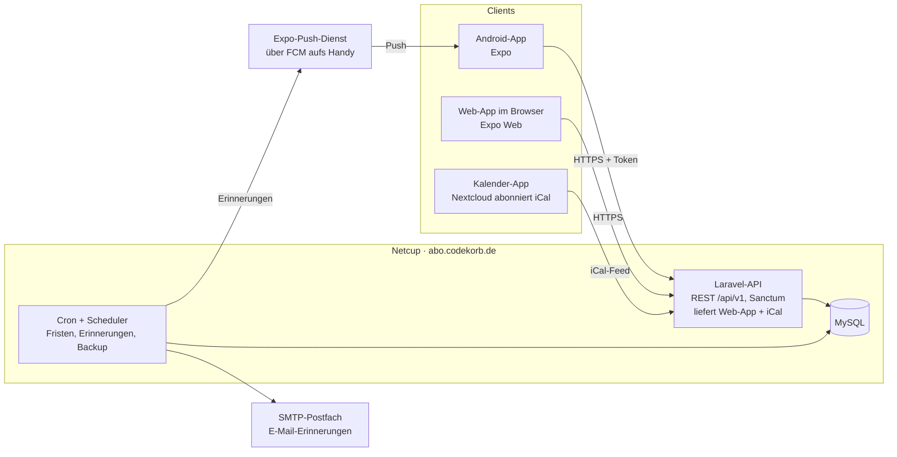

# Abo-Tracker · Technik-Spezifikation

Stand: 06.11.2026 · Quelle: Claude-Doc „Abo-Tracker · Technik-Spezifikation“

## Überblick & Entscheidungen

Der Abo-Tracker wird eine Laravel-API auf dem Netcup-Webspace unter abo.codekorb.de plus eine Expo-App, die als Android-App und als Web-Version für den Desktop gebaut wird. Ziel: jederzeit sehen, was die wiederkehrenden Kosten pro Monat ausmachen, und keine Kündigungsfrist mehr verpassen.

| Thema | Entscheidung | Begründung |
| --- | --- | --- |
| Hosting | Netcup Webhosting 8000, PHP + MySQL | vorhandener Server, kein Docker nötig |
| Backend | Laravel als REST-API | PHP-Erfahrung vorhanden, Scheduler, Mail, Auth eingebaut |
| App | React Native mit Expo | eine Codebasis für Android und Web (Desktop) |
| Plattform | zuerst nur Android | kein Apple-Entwicklerkonto nötig |
| Nutzer | mehrere, Daten strikt getrennt | Freunde mit eigenen Konten |
| Login | E-Mail + Passwort, BearID vorerst nicht | BearID bleibt nur für den Eigentümer; später nachrüstbar |
| Erinnerungen | Push (Expo) + E-Mail | Cronjob auf dem Server |
| Domain | abo.codekorb.de | API unter /api, Web-App unter / |
| Design | Dark-Mode-Entwurf vom Canvas „Abo-Tracker Design“ | 11 Screens als Vorlage, siehe `docs/DESIGN.md` |

## Architektur

Android-App, Web-App und Kalender sprechen nur mit der Laravel-API; der Scheduler auf demselben Webspace verschickt Erinnerungen über den Expo-Push-Dienst und ein SMTP-Postfach.



- **Laravel-API:** REST-Endpunkte, Authentifizierung (Sanctum), Rechenlogik, Auslieferung der Web-App und des iCal-Feeds.
- **Scheduler:** läuft per Cronjob, weil auf dem Webspace keine Dauerprozesse möglich sind; schreibt Fristen fort, verschickt Erinnerungen, arbeitet die Queue ab, erstellt Backups.
- **Expo-App:** eine Codebasis (TypeScript, Expo Router) für Android und Browser; speichert die letzte Antwort lokal, damit die Übersicht auch offline sofort erscheint.
- **Externe Dienste:** Expo-Push (kostenlos, leitet über Firebase Cloud Messaging an Android weiter) und ein Netcup-Postfach für Mails. Keine weiteren Fremddienste.

## Datenmodell

Kern ist die Tabelle `subscriptions`; alles andere hängt daran oder am Nutzer. Beträge liegen als Ganzzahl in Cent, Datumswerte als `DATE`, gerechnet wird in der Zeitzone Europe/Berlin.

| Tabelle | Wichtige Felder | Zweck |
| --- | --- | --- |
| `users` | name, email, password, email_verified_at, timezone | Konto je Person |
| `invitations` | email, token_hash, invited_by, expires_at, accepted_at | Einladungslinks für die Registrierung |
| `subscriptions` | user_id, category_id, name, amount_cents, interval_unit (week/month/year), interval_count, anchor_date, next_charge_date, start_date, min_term_months, renewal_months, notice_value + notice_unit, cancel_by_date, status (active/cancelled/paused), ends_at, payment_method, provider_url, notes, source (manual/import/template) | ein Abo inkl. Laufzeit und Frist |
| `categories` | user_id (null = Standard), name, color, sort | Streaming, Sport, Versicherung … |
| `price_changes` | subscription_id, old_cents, new_cents, effective_date, source, status (pending/accepted/dismissed) | erkannte oder eingetragene Preisänderungen |
| `reminder_settings` | user_id, offsets_days (z. B. [14, 3]), push, email | Erinnerungs-Einstellungen je Nutzer |
| `sent_reminders` | user_id, subscription_id, type (deadline/charge/price), due_date, offset_days, channel, sent_at | Protokoll, verhindert doppelte Erinnerungen |
| `push_tokens` | user_id, expo_token, device_name, last_seen_at | Geräte für Push |
| `import_batches` | user_id, bank_format, period_from, period_to, rows_total | ein CSV-Import (ohne Rohdatei) |
| `import_candidates` | batch_id, payee_normalized, creditor_id, mandate_ref, amount_cents, interval_guess, occurrences, confidence, subscription_id, status (new/accepted/ignored/duplicate) | erkannte wiederkehrende Zahlungen |
| `import_rules` | user_id, creditor_id, mandate_ref, pattern, subscription_id | gemerkte Zuordnung Empfänger → Abo |
| `usage_checks` | user_id, subscription_id, answer (often/rare/never), checked_at | Antworten aus „Lohnt sich das noch?“ |
| `calendar_feeds` | user_id, token_hash, options (json) | privater iCal-Link |
| `templates` | key, name, category, interval_unit | Vorlagen ohne Preise, global |

- Indizes: `subscriptions(user_id, status, next_charge_date)` und `subscriptions(user_id, cancel_by_date)` für Übersicht und Erinnerungslauf.
- `sent_reminders` bekommt einen Unique-Index auf (subscription_id, type, due_date, offset_days, channel), damit ein doppelt laufender Cronjob nichts doppelt verschickt.
- Abos werden per Soft Delete entfernt, damit Statistik und Preisverlauf erhalten bleiben.
- Standardkategorien (Seeder): Telefon & Internet, Streaming, Sport, Software & Cloud, Versicherung, Mobilität, Sonstiges. Farben siehe `docs/DESIGN.md`.

## API-Endpunkte

Alle Endpunkte liegen unter `https://abo.codekorb.de/api/v1`, sprechen JSON und verlangen außer Auth und iCal ein Sanctum-Token (`Authorization: Bearer …`). Jede Abfrage ist auf den eingeloggten Nutzer beschränkt (Laravel Policies).

| Bereich | Methode + Pfad | Liefert / tut |
| --- | --- | --- |
| Auth | `POST /auth/register` (mit Einladungstoken) · `POST /auth/login` · `POST /auth/logout` | Konto anlegen, Token holen, Token löschen |
| Auth | `POST /auth/forgot-password` · `POST /auth/reset-password` · `GET /me` | Passwort zurücksetzen, eigenes Profil |
| Einladungen | `POST /invitations` · `GET /invitations/{token}` | Einladung verschicken (nur Admin), Einladung prüfen |
| Übersicht | `GET /dashboard?period=month` bzw. `?period=year` | Summe, Kategorien-Anteile, demnächst fällig, größte Posten |
| Abos | `GET /subscriptions` (Filter: status, category, q, sort) · `POST /subscriptions` | Liste, neues Abo |
| Abos | `GET` · `PATCH` · `DELETE /subscriptions/{id}` | Detail inkl. Fristen und Preisverlauf, ändern, löschen |
| Kündigung | `POST /subscriptions/{id}/cancel` · `POST /subscriptions/{id}/reactivate` | als gekündigt markieren (ends_at), rückgängig |
| Kündigung | `GET /subscriptions/{id}/cancellation-letter?format=text` bzw. `?format=pdf` | Kündigungsschreiben mit Platzhaltern |
| Preise | `GET /price-changes?status=pending` · `POST /price-changes/{id}/accept` · `POST /price-changes/{id}/dismiss` | Preisänderungen prüfen |
| Kalender | `GET /calendar?month=2026-11` | Abbuchungen je Tag für die Monatsansicht |
| Statistik | `GET /stats/history?months=12` · `GET /stats/reserve` | Verlauf der Fixkosten, Rücklage-Plan |
| Nutzung | `GET /usage-check/next` · `POST /usage-check` | nächstes Abo zum Bewerten, Antwort speichern |
| Import | `POST /imports` (multipart CSV + bank_format) · `GET /imports/{id}/candidates` · `POST /imports/{id}/apply` | hochladen, Vorschläge holen, ausgewählte übernehmen |
| Stammdaten | `GET /categories` · `POST` · `PATCH` · `DELETE /categories/{id}` · `GET /templates?q=` | Kategorien, Vorlagen-Suche |
| Einstellungen | `GET` · `PUT /settings/reminders` · `POST /push-tokens` · `DELETE /push-tokens/{token}` | Erinnerungen, Gerät für Push anmelden |
| iCal | `GET /settings/calendar-feed` · `POST /settings/calendar-feed/rotate` | Link anzeigen, neu erzeugen |
| iCal (öffentlich) | `GET /ical/{token}.ics` | Kalender-Feed, nur per geheimem Token |

Antworten liefern Beträge immer als `amount_cents` plus `monthly_cents` (auf den Monat umgerechnet), damit die App nicht selbst rechnet.

## Fachlogik

Alle Rechenregeln liegen im Backend in eigenen Service-Klassen (`BillingCalculator`, `DeadlineCalculator`, `ReserveCalculator`), mit Unit-Tests für Monatsenden, Schaltjahre und Zeitumstellung.

**Umrechnung auf den Monat**

```
monthly_cents = amount_cents × f / interval_count
f = 52/12 (week) · 1 (month) · 1/12 (year)
```

Vierteljährlich = month × 3, halbjährlich = month × 6. Gerundet wird erst bei der Anzeige von Summen, nicht pro Abo, damit sich Rundungsfehler nicht aufaddieren (intern mit Dezimal-/Bruchrechnung summieren, am Ende runden).

**Nächste Abbuchung**

- Ausgangspunkt ist `anchor_date` (der erste bekannte Abbuchungstag). Die nächste Abbuchung ist der erste Termin anchor + n × Intervall, der heute oder später liegt.
- Monatsenden: Ein Abo vom 31. wird im Februar am 28./29. gebucht und springt im März wieder auf den 31. (Carbon `addMonthsNoOverflow`, immer vom Anker aus gerechnet).
- Gekündigte Abos haben keine nächste Abbuchung nach `ends_at`; pausierte erscheinen nicht in Summen.

**Kündigungsfrist**

1. Laufzeitende berechnen: Start + Mindestlaufzeit; danach in Schritten der Verlängerung (`renewal_months`), bis das Ende in der Zukunft liegt.
2. `cancel_by_date` = Laufzeitende minus Frist (`notice_value` Tage/Wochen/Monate).
3. Abos ohne Mindestlaufzeit („jederzeit kündbar“) bekommen kein `cancel_by_date`; die Frist ist dann der Tag vor der nächsten Abbuchung.
4. Neu berechnet wird beim Speichern und täglich im Scheduler.

**Erinnerungen**

- Der Scheduler läuft täglich um 07:00 (`reminders:dispatch`) und sucht Fristen, die genau einen der Abstände aus `offsets_days` (Standard 14 und 3 Tage) entfernt sind.
- Pro Treffer wird je Kanal (Push, E-Mail) ein Eintrag in `sent_reminders` angelegt; existiert er schon, wird nichts gesendet. So schadet ein doppelter oder verspäteter Cron-Lauf nicht.
- Verpasster Lauf (Server down): Fristen, deren Erinnerungstag in den letzten 2 Tagen lag und die noch nicht abgelaufen sind, werden nachgeholt.
- Weitere Anlässe: neue Preisänderung (sofort nach Import) und optional „Abbuchung morgen“.

**Preisänderungen**

- Weicht eine importierte Buchung um mehr als 1 % oder 0,10 € vom gespeicherten Betrag ab, entsteht ein `price_change` mit Status pending.
- Annehmen setzt `amount_cents` ab `effective_date`; der alte Betrag bleibt im Verlauf.

**Rücklage für Jahresabos**

- Monatliche Rücklage = Summe aller Abos mit Intervall ≥ 3 Monate, auf 12 Monate umgerechnet, geteilt durch 12.
- Startpuffer: Die nächsten 12 Monate werden simuliert (jeden Monat + Rücklage, minus fällige Zahlungen). Der tiefste Minusstand, aufgerundet auf 10 €, ist der empfohlene Puffer.

## CSV-Import & Erkennung

Der Import läuft komplett auf dem Server und speichert nur erkannte Abo-Buchungen; die hochgeladene Datei wird nach dem Parsen sofort gelöscht.

1. **Hochladen:** CSV (max. 2 MB) plus gewähltes Bankformat. Beim ersten Import fragt die App das Format ab und merkt es sich.
2. **Parsen:** Ein Adapter je Bank liest Datum, Empfänger, Verwendungszweck und Betrag. Zeichensatz (UTF-8 / ISO-8859-1), Trennzeichen (`;`) und deutsches Zahlenformat (`-16,99`) werden normalisiert. Nur Abbuchungen (negative Beträge) zählen.
3. **Normalisieren:** Empfänger in Großbuchstaben, ohne Zahlenfolgen, Referenzen und Zahlungsdienst-Präfixe (z. B. „PAYPAL *“, „SEPA-LASTSCHRIFT“).
4. **Gruppieren:** Buchungen mit gleichem normalisierten Empfänger und ähnlichem Betrag (± 10 %) bilden eine Gruppe.
5. **Rhythmus erkennen:** Median der Abstände zwischen den Buchungen. 26–35 Tage = monatlich, 85–95 = vierteljährlich, 175–190 = halbjährlich, 355–375 = jährlich. Ab 3 Treffern gilt ein Kandidat als sicher, bei 1–2 Treffern wird er mit „Rhythmus prüfen“ markiert.
6. **Abgleich:** Passt eine Gruppe zu einer `import_rule` oder zu einem vorhandenen Abo (Name + Betrag), wird sie als Duplikat ausgegraut oder als Preisänderung gemeldet.
7. **Übernehmen:** Die ausgewählten Kandidaten werden Abos (source = import). Für jeden entsteht eine `import_rule`, damit der nächste Import sie automatisch zuordnet.

**Erster Adapter: Sparkasse (CSV-CAMT V2)**

Im Online-Banking unter Umsätze den Zeitraum ab 01.01.2026 wählen und als „CSV-CAMT V2“ exportieren. Die Spalten unten sind der übliche Aufbau dieses Formats; **der Adapter wird gegen eine echte (anonymisierte) Datei geprüft, bevor er fertig ist.**

| Spalte im Export | Verwendung im Import |
| --- | --- |
| Buchungstag | Datum der Abbuchung (Format TT.MM.JJ) |
| Beguenstigter/Zahlungspflichtiger | Empfänger, wird normalisiert |
| Verwendungszweck | Zusatzhinweis für die Erkennung, z. B. Vertragsnummer |
| Glaeubiger ID | stärkstes Merkmal: gleiche ID = gleicher Lastschrift-Empfänger |
| Mandatsreferenz | unterscheidet zwei Verträge beim selben Anbieter |
| Betrag | negativer Betrag = Abbuchung, Komma als Dezimaltrennzeichen |
| Buchungstext | filtert Daueraufträge und Lastschriften heraus |
| Kontonummer/IBAN, BIC | wird nicht gespeichert |

- Zeichensatz: meist ISO-8859-1 (Windows-1252); der Adapter erkennt und wandelt nach UTF-8.
- Lastschriften mit Gläubiger-ID und Mandatsreferenz werden zuerst gruppiert, erst danach greift die Gruppierung nach Empfängername.
- Ein Export ab Januar deckt rund zehn Monate ab: Monats- und Quartalsabos werden sicher erkannt, Jahresabos erscheinen nur einmal und bekommen „Rhythmus prüfen“.
- Adapter als Interface (`BankStatementParser`) bauen, damit weitere Banken (ING, DKB, generisch mit Spaltenzuordnung) später nur eine neue Klasse sind.

## Sicherheit & Datenschutz

Weil Freunde eigene Konten bekommen und Kontoauszüge verarbeitet werden, gelten von Anfang an diese Regeln:

- **Datentrennung:** Jedes Model mit `user_id` bekommt einen Global Scope plus Policy; ein Feature-Test prüft je Endpunkt, dass Nutzer B die Daten von Nutzer A nicht lesen oder ändern kann.
- **Registrierung:** Nur per Einladungslink (signierte URL, 7 Tage gültig), damit sich keine Fremden anmelden. E-Mail-Bestätigung Pflicht.
- **Passwörter & Tokens:** bcrypt (Laravel-Standard), Mindestlänge 12. Sanctum-Tokens je Gerät, in der App im Android Keystore (`expo-secure-store`), widerrufbar. Login mit Rate Limit (5 Versuche pro Minute).
- **Transport:** Nur HTTPS (Let's Encrypt im Netcup-Panel), HSTS aktiv.
- **Kontoauszüge:** Rohdatei nie dauerhaft gespeichert; in `import_candidates` landen nur Empfänger, Betrag, Datum der Abo-Buchungen, keine IBANs oder anderen Umsätze.
- **iCal-Link:** zufälliges Token (32 Byte), in der Datenbank nur als Hash; jederzeit neu erzeugbar. Feed enthält optional keine Beträge.
- **Push-Inhalte:** keine Beträge auf dem Sperrbildschirm, nur „Frist für Adobe CC in 3 Tagen“.
- **Backups:** nächtlicher MySQL-Dump per Cron, verschlüsselt, zusätzlich in die Nextcloud.
- **Konto löschen:** löscht alle Daten des Nutzers endgültig (DSGVO), Export als JSON/CSV vorher möglich.

## Deployment & Android-Build

API und Web-Version laufen zusammen auf abo.codekorb.de; die Android-App wird über Expo EAS gebaut und als APK verteilt.

**Server (Netcup Webhosting 8000)**

1. Subdomain abo.codekorb.de anlegen, Dokumentenwurzel auf den Laravel-Ordner `public/` setzen, PHP auf die aktuelle 8.x-Version stellen, Let's-Encrypt-Zertifikat aktivieren.
2. MySQL-Datenbank im Panel anlegen, Zugangsdaten in `.env` (außerhalb von `public/`).
3. Ausrollen: `composer install --no-dev` und Web-Build lokal oder per GitHub Actions, dann per SFTP/rsync hochladen; danach `php artisan migrate --force` und `php artisan optimize`. Wenn das Paket SSH bietet, läuft das als ein Deploy-Skript.
4. Cronjob im Panel: `php artisan schedule:run` so oft, wie das Paket erlaubt (ideal minütlich). Der Scheduler startet Erinnerungen, Fristen-Neuberechnung, Backup und arbeitet die Queue ab (`queue:work --stop-when-empty`, Treiber database), da dauerhaft laufende Prozesse auf dem Webspace nicht möglich sind.
5. Mails über SMTP mit einem Netcup-Postfach (z. B. abo@codekorb.de), SPF und DKIM für die Domain prüfen.

**App (Expo)**

- Projekt mit Expo Router und TypeScript; dieselben Screens laufen als Android-App und im Browser.
- Web-Version: `npx expo export --platform web` erzeugt statische Dateien, die Laravel unter `/` ausliefert (alle Nicht-API-Pfade fallen auf `index.html` zurück).
- Android: `eas build -p android --profile preview` erzeugt eine APK zum direkten Installieren; für Freunde später optional ein interner Play-Testkanal.
- Push: Firebase-Projekt anlegen, FCM-Zugangsdaten in EAS hinterlegen; die App meldet ihr Expo-Push-Token an `POST /push-tokens`. Der Server schickt Pushes per HTTP an den Expo-Push-Dienst.
- Kleine Updates ohne neue APK: EAS Update (Over-the-Air) für JavaScript-Änderungen.

**Code-Organisation**

Ein GitHub-Repo mit zwei Ordnern: `api/` (Laravel) und `app/` (Expo). Beide Seiten liegen so in einem Kontext.

## Umsetzungsreihenfolge & offene Punkte

Gebaut wird in sechs Meilensteinen; nach M2 ist der Tracker schon im Alltag nutzbar, alles danach macht ihn besser.

1. **M1 · Fundament:** Repo, Laravel-Projekt, Deployment auf abo.codekorb.de, Auth mit Einladung, Expo-Projekt mit Login und Dark-Theme aus dem Design. → Details in `docs/START-M1.md`
2. **M2 · Abos & Übersicht:** Abo anlegen (mit Vorlagen), Liste, Detail, Übersicht mit Monat/Jahr, Kategorien, Umrechnung, nächste Abbuchung, Kündigungsfrist.
3. **M3 · Erinnerungen:** Scheduler, E-Mail, Push über Expo, Erinnerungs-Einstellungen, Protokoll gegen Doppelversand.
4. **M4 · CSV-Import:** Sparkasse-Adapter (CSV-CAMT V2), Erkennung, Import-Screen, Import-Regeln, Preisänderungen.
5. **M5 · Sparen:** Kündigungsassistent mit Schreiben/PDF, „Lohnt sich das noch?“, Preisänderungs-Screen.
6. **M6 · Überblick:** Monatsansicht, Rücklage, Statistik-Verlauf, iCal-Feed, Desktop-Layout der Web-Version.

**Offene Punkte**

- [x] Bank: Sparkasse, Export als CSV-CAMT V2 ab 01.01.2026. Anonymisierte Beispieldatei zum Testen des Adapters bereitlegen.
- [ ] Erlaubt das Netcup-Paket SSH und minütliche Cronjobs? (im Panel prüfen)
- [ ] Name der App: „Abo-Tracker“ als Arbeitstitel oder ein eigener Name?
- [ ] Soll das Tool in Bear Cave verlinkt werden, auch wenn der Login vorerst eigenständig ist?
- [ ] Startkategorien und Standard-Erinnerungsabstände (14 und 3 Tage) so übernehmen?
